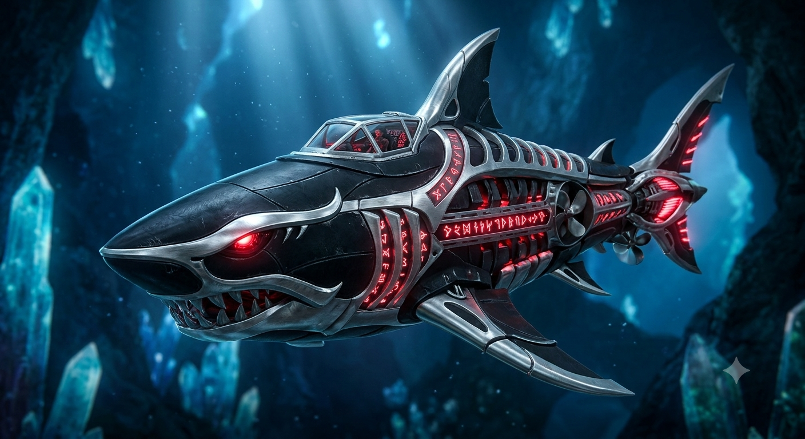

# ТЗ: Роботизированный мегалодон "RoboMeg"

Автор: Полякова Арина Витальевна
Стихия: вода
Проект: Роботизированный мегалодон "RoboMeg"

## 1. Назначение

Роботизированный мегалодон «RoboMeg» — автономный биомеханический подводный аппарат чёрного цвета с бронированной капсулой управления для одного пилота внутри корпуса. Предназначен для скоростного перемещения в водной среде, преодоления морских препятствий и совершения баллистических прыжков по воздуху через небольшие острова и преграды. Оснащён челюстным биореактором, позволяющим разрушать преграды и восполнять запас энергии за счёт охоты на рыбу в открытой воде.



## 2. Стихия и конструкционный элемент

Стихия: вода

Конструкционный элемент: гидрореактивный хвостовой плавник и челюстной механизм с биореактором.

Как реализован элемент:
- Гидрореактивный хвостовой плавник определяет максимальную длину баллистического прыжка над водой за один импульс (атрибут `jump_length_km`).
- Челюстной механизм с биореактором определяет силу укуса (атрибут `bite_force_kn`) для разрушения препятствий (айсбергов, стальных сетей) и позволяет восполнять энергию путём поедания рыбы (метод `hunt_fish`).

Ограничения стихии:
- Основной режим — движение в воде (индекс расхода энергии 1).
- Способен кратковременно переходить в воздушную среду при прыжке на расстояние не более `jump_length_km` (индекс расхода энергии 2).
- Не предназначен для передвижения по суше (земле).

## 3. Публичный интерфейс

### 3.1. Класс
Имя класса: `RoboMeg`

Модуль: `robo_meg.py`

Константы класса:
- `HUNT_CIRCLE_DIAMETER_KM: float = 2.0` — фиксированный диаметр манёвра (круга) для охоты на рыбу, км.
- `HUNT_ENERGY_GAIN: float = 20.0` — чистый прирост энергии за один цикл охоты, условные единицы.

### 3.2. Конструктор
```python
def __init__(
    self,
    name: str,
    mass_kg: float,
    jump_length_km: float,
    bite_force_kn: float,
    max_speed_kmh: float,
    energy: float = 100.0,
) -> None:
```

| Параметр | Тип | Единица | Допустимый диапазон | Значение по умолчанию |
|----------|-----|---------|---------------------|-----------------------|
| `name` | str | — | непустая строка | — |
| `mass_kg` | float | кг | $> 0$ | — |
| `jump_length_km` | float | км | $> 0$ | — |
| `bite_force_kn` | float | кН | $> 0$ | — |
| `max_speed_kmh` | float | км/ч | $> 0$ | — |
| `energy` | float | условные единицы | $0 \dots 100$ | 100.0 |

Исключения из конструктора:
- `TypeError` — если `name` не является строкой (`str`), либо числовые параметры не являются `int` или `float` (`bool` не допускается).
- `ValueError` — если `name` пустой или состоит только из пробелов.
- `ValueError` — если `mass_kg`, `jump_length_km`, `bite_force_kn` или `max_speed_kmh` $\le 0$.
- `ValueError` — если `energy` вне диапазона $0 \dots 100$.

### 3.3. Атрибуты

| Атрибут | Тип | Единица | Доступ | Описание |
|---------|-----|---------|--------|----------|
| `name` | str | — | чтение | Имя транспорта |
| `mass_kg` | float | кг | чтение | Масса аппарата |
| `jump_length_km` | float | км | чтение | Максимальная длина одного прыжка по воздуху |
| `bite_force_kn` | float | кН | чтение | Сила сжатия челюстей |
| `max_speed_kmh` | float | км/ч | чтение | Максимальная скорость в воде |
| `energy` | float | условные единицы | чтение | Текущий запас энергии |
| `position_km` | float | км | чтение | Пройденное расстояние по маршруту (по умолчанию 0.0) |
| `is_airborne` | bool | — | чтение | Находится ли аппарат в фазе прыжка в воздухе (по умолчанию False) |

### 3.4. Методы

#### 3.4.1. move
```python
def move(self, distance_km: float, terrain: str) -> float:
```
Назначение: перемещает мегалодон на заданное расстояние в указанной среде.
Параметры:
- `distance_km` — расстояние в км, $> 0$.
- `terrain` — среда: `"water"`, `"air"`, `"ground"`.
Возвращает: время перемещения в часах (`float`).
Изменяет: `position_km`, `energy`, `is_airborne` (а также внутренний счётчик проплытой дистанции после прыжка).
Исключения:
- `TypeError` — при передаче параметров неверного типа.
- `ValueError` — если `distance_km` $\le 0$ или `terrain` не из списка.
- `RoboMegCannotMoveOnGround` — при попытке движения по земле (`terrain == "ground"`).
- `JumpTooLong` — при попытке прыжка по воздуху (`terrain == "air"`) на расстояние `distance_km > jump_length_km`.
- `EnergyEmpty` — если `energy` меньше затрат энергии на заданное расстояние.
Правила:
- В воде (`"water"`): скорость = `max_speed_kmh`, расход энергии = `distance_km * 1`.
- В воздухе (`"air"`): скорость = `max_speed_kmh * 2`, расход энергии = `distance_km * 2`.
- На земле (`"ground"`): транспорт двигаться не может (`RoboMegCannotMoveOnGround`).
- `is_airborne = True`, если `terrain == "air"`, иначе `False`.
- При движении в воде внутренний запас безопасной дистанции позади аппарата увеличивается на `distance_km`; при прыжке по воздуху он сбрасывается в `0.0`.
- При любом исключении состояние объекта не меняется.

#### 3.4.2. pass_island
```python
def pass_island(self, diameter_km: float) -> float:
```
Назначение: преодолевает встреченный на пути остров оптимальным способом (перепрыгивает по воздуху или обплывает по полукругу в воде).
Параметры:
- `diameter_km` — диаметр острова в км, $> 0$.
Возвращает: время преодоления острова в часах (`float`).
Изменяет: `position_km`, `energy`, `is_airborne`.
Исключения:
- `TypeError` — если `diameter_km` не число.
- `ValueError` — если `diameter_km` $\le 0$.
- `EnergyEmpty` — если текущего запаса `energy` недостаточно для выбранного манёвра.
Правила:
- Если `diameter_km < jump_length_km`: мегалодон перепрыгивает остров по воздуху (выполняется перемещение в среде `"air"` на расстояние `diameter_km`, расход энергии = `diameter_km * 2`, скорость = `max_speed_kmh * 2`, `is_airborne = True`).
- Если `diameter_km >= jump_length_km`: мегалодон обплывает остров по полукругу в воде. Длина полукруга рассчитывается с фиксированным коэффициентом ($\pi \approx 3.0$) как `arc_km = 1.5 * diameter_km`. Выполняется перемещение в среде `"water"` на расстояние `arc_km` (расход энергии = `arc_km * 1`, скорость = `max_speed_kmh`, `is_airborne = False`).
- При нехватке энергии выбрасывается `EnergyEmpty`, состояние не меняется.

#### 3.4.3. hunt_fish
```python
def hunt_fish(self) -> None:
```
Назначение: восполняет энергию на 20 единиц путём совершения кормового круга диаметром 2 км назад от текущей точки с поеданием рыбы и возвратом в исходную точку.
Параметры: нет.
Возвращает: `None`.
Изменяет: `energy` ($+20.0$ единиц), фиксирует текущую точку `position_km` как выловленную. `position_km` и `is_airborne` не меняются.
Исключения:
- `RoboMegNotHungry` — если `energy >= 50`.
- `UnsafeHuntingZone` — если мегалодон находится в воздухе (`is_airborne == True`) или с момента старта / последнего прыжка проплыл по воде расстояние меньше диаметра круга охоты (`2.0` км).
- `NoFishHere` — если в текущей точке маршрута (`position_km`) охота уже производилась.
Правила:
- Охота разрешена только при `energy < 50`.
- Чтобы сделать круг назад диаметром `2.0` км и не врезаться в берег или только что перепрыгнутый остров, мегалодон должен находиться в воде и иметь позади себя минимум `2.0` км непрерывного водного пути.
- В одной и той же координате `position_km` нельзя охотиться дважды подряд (даже если после первого круга энергия осталась $< 50$). Для новой охоты необходимо проплыть вперёд.
- Успешная охота увеличивает `energy` на `20.0`.

#### 3.4.4. can_overcome
```python
def can_overcome(self, obstacle: str) -> bool:
```
Назначение: проверяет, может ли мегалодон преодолеть морское препятствие в текущем состоянии.
Параметры:
- `obstacle` — тип препятствия: `"coral_reef"`, `"iceberg"`, `"steel_net"`, `"whirlpool"`.
Возвращает: `True` / `False`.
Исключения:
- `TypeError` — если `obstacle` не строка.
- `ValueError` — если `obstacle` не из списка.
Правила:
- `"coral_reef"` (коралловый риф) — только если мегалодон находится в прыжке (`is_airborne == True`).
- `"iceberg"` (айсберг) — только если `bite_force_kn > 50` и `energy > 30`.
- `"steel_net"` (стальная сеть) — если мегалодон в прыжке (`is_airborne == True`) ИЛИ может перекусить тросы (`bite_force_kn > 25`).
- `"whirlpool"` (водоворот) — только если мегалодон в воде (`is_airborne == False`), `max_speed_kmh >= 60` и `energy > 40`.

#### 3.4.5. calculate_energy
```python
def calculate_energy(self, distance_km: float, terrain: str) -> float:
```
Назначение: рассчитывает затраты энергии на участок пути без изменения состояния транспорта.
Параметры: те же, что у `move`.
Возвращает: затраты энергии (`float`).
Исключения:
- `TypeError` — если параметры имеют неподходящий тип.
- `ValueError` — если `distance_km` $\le 0$ или `terrain` не из списка `"water"`, `"air"`, `"ground"`.
Правила:
- Возвращает `distance_km * 1` для `"water"` и `distance_km * 2` для `"air"`.
- Для `"ground"` выбрасывает `RoboMegCannotMoveOnGround`.
- Не зависит от текущего запаса `energy` и `jump_length_km` (`EnergyEmpty` и `JumpTooLong` не возникают).

#### 3.4.6. refuel
```python
def refuel(self, amount: float) -> None:
```
Назначение: сервисное пополнение энергии биореактора на станции.
Параметры:
- `amount` — количество энергии, $> 0$.
Возвращает: `None`.
Изменяет: `energy`, но не выше `100.0`.
Исключения:
- `TypeError` — если `amount` не число.
- `ValueError` — если `amount` $\le 0$.

#### 3.4.7. get_status
```python
def get_status(self) -> dict:
```
Назначение: возвращает снимок текущего состояния аппарата.
Возвращает: словарь с ключами:
- `"name"` — `str`,
- `"energy"` — `float`,
- `"position_km"` — `float`,
- `"is_airborne"` — `bool`,
- `"jump_length_km"` — `float`,
- `"bite_force_kn"` — `float`.

## 4. Сценарии

### 4.1. Модульные тесты

#### Сценарий 1. Обычный заплыв в воде
Дано: мегалодон с `energy = 100`, `max_speed_kmh = 50`.
Когда: `move(25, "water")`.
Тогда:
- возвращается `0.5` ($25 / 50$);
- `position_km == 25`;
- `energy == 75` ($100 - 25 \times 1$);
- `is_airborne == False`.

#### Сценарий 2. Прыжок через небольшой остров
Дано: мегалодон с `energy = 80`, `jump_length_km = 5`, `max_speed_kmh = 50`.
Когда: `pass_island(3)`.
Тогда:
- так как $3 < 5$, остров преодолевается прыжком по воздуху;
- возвращается `0.03` ($3 / (50 \times 2)$);
- `position_km == 3`;
- `energy == 74` ($80 - 3 \times 2$);
- `is_airborne == True`.

#### Сценарий 3. Обплыв крупного острова по полукругу
Дано: мегалодон с `energy = 80`, `jump_length_km = 5`, `max_speed_kmh = 50`.
Когда: `pass_island(6)`.
Тогда:
- так как $6 \ge 5$, мегалодон обплывает остров по полукругу длины `9.0` км ($1.5 \times 6$);
- возвращается `0.18` ($9 / 50$);
- `position_km == 9`;
- `energy == 71` ($80 - 9 \times 1$);
- `is_airborne == False`.

#### Сценарий 4. Успешная охота на рыбу
Дано: мегалодон с `energy = 40`, проплывший по воде 5 км (`position_km == 5`, `is_airborne == False`).
Когда: `hunt_fish()`.
Тогда:
- `energy == 60` ($40 + 20$);
- `position_km == 5` (возврат в исходную точку после круга);
- `is_airborne == False`.

### 4.2. Функциональные (сценарные) тесты

#### Сценарий: Архипелаг островов и охота после прыжка

**Given:** роботизированный мегалодон «RoboMeg» с `mass_kg = 4000`, `jump_length_km = 4`, `bite_force_kn = 60`, `max_speed_kmh = 50` и `energy = 60`.

**And:** мегалодон находится на старте в воде: `position_km = 0`, `is_airborne = False`.

**When:** пилот направляет мегалодон через первый малый остров диаметром 3 км: `pass_island(3)`.

**Then:** поскольку $3 < 4$, мегалодон перепрыгивает остров по воздуху за `0.03` ч ($3 / 100$).

**And:** `position_km == 3`, `energy == 54` ($60 - 3 \times 2$), `is_airborne == True`.

**When:** пилот пытается сразу поохотиться на рыбу: `hunt_fish()`.

**Then:** возникает исключение `RoboMegNotHungry`, так как `energy = 54 >= 50`.

**When:** мегалодон проплывает в воде ещё 5 км: `move(5, "water")`.

**Then:** время заплыва равно `0.1` ч ($5 / 50$), `position_km == 8`, `energy == 49`, `is_airborne == False`.

**When:** на пути встречается второй остров диаметром 2 км, и пилот преодолевает его: `pass_island(2)`.

**Then:** мегалодон перепрыгивает остров по воздуху: `position_km == 10`, `energy == 45`, `is_airborne == True`.

**When:** пилот пытается поохотиться сразу после прыжка: `hunt_fish()`.

**Then:** возникает `UnsafeHuntingZone`, так как мегалодон в фазе прыжка и не отплыл по воде на 2 км от острова.

**When:** пилот проплывает по воде всего 1 км: `move(1, "water")`.

**Then:** `position_km == 11`, `energy == 44`, `is_airborne == False`.

**When:** пилот снова пытается начать охоту: `hunt_fish()`.

**Then:** снова возникает `UnsafeHuntingZone`, поскольку после прыжка проплыто только 1 км по воде, а диаметр круга охоты требует минимум 2 км.

**When:** пилот проплывает по воде ещё 1 км: `move(1, "water")`.

**Then:** `position_km == 12`, `energy == 43`, суммарный водный путь после прыжка достигает 2 км.

**When:** пилот запускает охоту на рыбу: `hunt_fish()`.

**Then:** мегалодон делает круг назад, поедает рыбу и возвращается в точку `position_km == 12`, а `energy` увеличивается до `63` ($43 + 20$).

**When:** впереди появляется крупный остров диаметром 6 км: `pass_island(6)`.

**Then:** поскольку $6 \ge 4$, мегалодон обплывает его по полукругу длиной `9` км ($1.5 \times 6$) за `0.18` ч ($9 / 50$).

**And:** итоговое состояние: `position_km == 21`, `energy == 54`, `is_airborne == False`.

#### Сценарий: Запрет повторной охоты в одной точке при критическом заряде

**Given:** мегалодон «RoboMeg» с `mass_kg = 4000`, `jump_length_km = 4`, `bite_force_kn = 60`, `max_speed_kmh = 50` и `energy = 25`.

**And:** `position_km = 0`, `is_airborne = False`.

**When:** пилот проплывает 3 км в открытое море: `move(3, "water")`.

**Then:** `position_km == 3`, `energy == 22`, `is_airborne == False`.

**When:** пилот проводит охоту на рыбу: `hunt_fish()`.

**Then:** охота успешна, `energy == 42` ($22 + 20$), `position_km == 3`.

**When:** видя, что энергия всё ещё меньше 50, пилот пытается поохотиться второй раз подряд из той же точки: `hunt_fish()`.

**Then:** возникает исключение `NoFishHere`, так как в точке `position_km == 3` рыба уже съедена.

**And:** состояние не меняется: `energy == 42`, `position_km == 3`.

**When:** пилот проплывает вперёд ещё 2 км на новое рыбное место: `move(2, "water")`.

**Then:** `position_km == 5`, `energy == 40`.

**When:** пилот снова вызывает `hunt_fish()`.

**Then:** на новой точке охота проходит успешно, `energy == 60`, `position_km == 5`.

#### Сценарий: Штурм ледяного барьера, рифа и водоворота

**Given:** мегалодон «RoboMeg» с `mass_kg = 4000`, `jump_length_km = 5`, `bite_force_kn = 60`, `max_speed_kmh = 60` и `energy = 70`.

**And:** `position_km = 0`, `is_airborne = False`.

**When:** пилот плывёт 10 км в воде: `move(10, "water")`.

**Then:** `position_km == 10`, `energy == 60`, `is_airborne == False`.

**When:** пилот проверяет возможность пройти водоворот: `can_overcome("whirlpool")`.

**Then:** возвращается `True`, так как аппарат в воде, `max_speed_kmh = 60 >= 60` и `energy = 60 > 40`.

**When:** пилот проверяет возможность пройти коралловый риф из воды: `can_overcome("coral_reef")`.

**Then:** возвращается `False`, поскольку риф преодолевается только в прыжке.

**When:** пилот совершает прыжок на 4 км над рифом: `move(4, "air")`.

**Then:** `position_km == 14`, `energy == 52` ($60 - 4 \times 2$), `is_airborne == True`.

**When:** пилот повторно проверяет преодоление рифа: `can_overcome("coral_reef")`.

**Then:** возвращается `True`.

**When:** пилот погружается в воду и плывёт 25 км: `move(25, "water")`.

**Then:** `position_km == 39`, `energy == 27`, `is_airborne == False`.

**When:** пилот проверяет возможность пробить айсберг: `can_overcome("iceberg")`.

**Then:** возвращается `False`, так как `bite_force_kn = 60 > 50`, но `energy = 27 <= 30`.

**When:** пилот пополняет энергию через охоту: `hunt_fish()`.

**Then:** `energy == 47`, `position_km == 39`.

**When:** пилот снова проверяет айсберг: `can_overcome("iceberg")`.

**Then:** возвращается `True`, поскольку теперь `energy = 47 > 30`.

## 5. Граничные случаи

- `move(0, "water")` или `pass_island(0)` $\rightarrow$ `ValueError`.
- `move(1, "ground")` $\rightarrow$ `RoboMegCannotMoveOnGround`.
- `move(5, "air")` при `jump_length_km == 5` $\rightarrow$ успешно (прыжок ровно на предельную длину допустим); `move(5.1, "air")` $\rightarrow$ `JumpTooLong`.
- `pass_island(5)` при `jump_length_km == 5` $\rightarrow$ обплыв по воде на `7.5` км (так как диаметр равен длине прыжка, прыжок выполняется только при строгом неравенстве `diameter_km < jump_length_km`).
- `hunt_fish()` при `energy == 50.0` $\rightarrow$ `RoboMegNotHungry` (охота доступна строго при `energy < 50`).
- `hunt_fish()` после ровно `2.0` км в воде после прыжка $\rightarrow$ успешно (`water_distance_since_jump == 2.0` допустимо).
- `refuel(1000)` при `energy == 50` $\rightarrow$ `energy == 100.0` (не больше максимума).

## 6. Исключения и иерархия

### 6.1. Иерархия

```text
Exception
├── TypeError
├── ValueError
└── RuntimeError
    └── CrazyVehicleError
        └── RoboMegError
            ├── EnergyEmpty
            ├── RoboMegCannotMoveOnGround
            ├── JumpTooLong
            ├── RoboMegNotHungry
            ├── UnsafeHuntingZone
            └── NoFishHere
```

- `CrazyVehicleError` — базовое доменное исключение транспорта, наследуется от `RuntimeError`.
- `RoboMegError` — базовое исключение роботизированного мегалодона.
- `EnergyEmpty` — недостаточный запас энергии для перемещения или преодоления острова.
- `RoboMegCannotMoveOnGround` — попытка движения по суше.
- `JumpTooLong` — попытка прыжка по воздуху на дистанцию, превышающую `jump_length_km`.
- `RoboMegNotHungry` — попытка охоты при `energy >= 50`.
- `UnsafeHuntingZone` — попытка охоты в воздухе или менее чем в 2 км водного пути после прыжка/старта.
- `NoFishHere` — попытка повторной охоты в той же точке маршрута (`position_km`).

### 6.2. Таблица

| Ситуация | Исключение | Сообщение |
|----------|------------|-----------|
| `name`, `terrain` или `obstacle` имеет тип, отличный от `str` | `TypeError` | `"<parameter> must be a string"` |
| Числовой параметр конструктора или метода имеет тип, отличный от `int` или `float`; `bool` также не допускается | `TypeError` | `"<parameter> must be a number"` |
| Пустое имя мегалодона | `ValueError` | `"name must not be empty"` |
| `mass_kg` $\le 0$ | `ValueError` | `"mass_kg must be positive"` |
| `jump_length_km` $\le 0$ | `ValueError` | `"jump_length_km must be positive"` |
| `bite_force_kn` $\le 0$ | `ValueError` | `"bite_force_kn must be positive"` |
| `max_speed_kmh` $\le 0$ | `ValueError` | `"max_speed_kmh must be positive"` |
| `energy` вне диапазона $0 \dots 100$ при создании | `ValueError` | `"energy must be between 0 and 100"` |
| `distance_km` $\le 0$ в `move` или `calculate_energy` | `ValueError` | `"distance_km must be positive"` |
| `diameter_km` $\le 0$ в `pass_island` | `ValueError` | `"diameter_km must be positive"` |
| Неизвестная среда в `move` или `calculate_energy` | `ValueError` | `"unknown terrain: <terrain>"` |
| Неизвестное препятствие в `can_overcome` | `ValueError` | `"unknown obstacle: <obstacle>"` |
| `amount` $\le 0$ в `refuel` | `ValueError` | `"amount must be positive"` |
| `move` или `calculate_energy` вызывается с `terrain == "ground"` | `RoboMegCannotMoveOnGround` | `"robomeg cannot move on ground"` |
| `move` в среде `"air"` вызывается с `distance_km > jump_length_km` | `JumpTooLong` | `"jump distance <distance_km> exceeds max jump length <jump_length_km>"` |
| Энергии недостаточно для `move` или `pass_island` | `EnergyEmpty` | `"not enough energy: required <required>, have <energy>"` |
| Вызов `hunt_fish` при `energy >= 50` | `RoboMegNotHungry` | `"energy is 50 or above, hunting is not needed"` |
| Вызов `hunt_fish` в воздухе или при водном пути после прыжка/старта $< 2.0$ км | `UnsafeHuntingZone` | `"must swim at least 2.0 km in water before hunting"` |
| Повторный вызов `hunt_fish` на том же `position_km` | `NoFishHere` | `"fish already eaten at position <position_km>"` |

Сначала проверяются типы (`TypeError`) и допустимые значения параметров (`ValueError`), затем ограничения среды и прыжка (`RoboMegCannotMoveOnGround`, `JumpTooLong`), и в конце — достаточность энергии (`EnergyEmpty`). При любом исключении состояние объекта остаётся неизменным.

## 7. Что вне рамок

- Транспорт не взаимодействует с другими транспортами и морскими хищниками.
- Нет 3D-графики, анимации и визуализации заплыва или прыжка.
- Нет сохранения состояния между запусками программы.
- Не моделируются глубина погружения, давление воды, солёность, течения и рельеф морского дна.
- Не рассчитывается баллистическая парабола прыжка и сопротивление воздуха.
- Не моделируется размножение и миграция рыбы: наличие рыбы определяется только правилом уникальности координаты `position_km` и безопасной 2-километровой водной зоной позади.
- `position_km` хранит путевую дистанцию продвижения по маршруту (кормовая петля при охоте возвращает мегалодон в ту же точку и не увеличивает `position_km`).

## 8. Трассируемость «требование $\rightarrow$ тест»

| Требование | Раздел ТЗ | Тест |
|------------|-----------|------|
| Класс `RoboMeg` доступен из `robo_meg.py`; конструктор сохраняет параметры и устанавливает `position_km == 0.0`, `is_airborne == False` | 3.1, 3.2, 3.3 | `test_TC_M_001_init_stores_parameters` |
| Пустое имя мегалодона вызывает `ValueError` | 3.2, 6.2 | `test_TC_M_002_init_empty_name_raises` |
| Неположительные `mass_kg`, `jump_length_km`, `bite_force_kn`, `max_speed_kmh` вызывают `ValueError` | 3.2, 6.2 | `test_TC_M_003_init_nonpositive_params_raise` |
| Границы начальной энергии 0 и 100 допустимы, выход за пределы вызывает `ValueError` | 3.2, 6.2 | `test_TC_M_004_init_energy_bounds` |
| Публичные атрибуты доступны только для чтения и имеют верные типы | 3.3 | `test_TC_M_005_public_attributes_read_only_and_types` |
| Движение в воде тратит `distance_km * 1` энергии, скорость равна `max_speed_kmh`, `is_airborne == False` | 3.4.1, 4.1 | `test_TC_M_006_move_water` |
| Прыжок в воздухе при `distance_km <= jump_length_km` тратит `distance_km * 2` энергии, скорость `max_speed_kmh * 2`, `is_airborne == True` | 3.4.1, 5 | `test_TC_M_007_move_air_valid_jump` |
| Прыжок в воздухе при `distance_km > jump_length_km` вызывает `JumpTooLong` без изменения состояния | 3.4.1, 6.2 | `test_TC_M_008_move_air_exceeds_jump_length_raises` |
| Движение по земле вызывает `RoboMegCannotMoveOnGround` | 3.4.1, 6.2 | `test_TC_M_009_move_ground_raises` |
| Нехватка энергии в `move` и `pass_island` вызывает `EnergyEmpty`; точное совпадение обнуляет энергию | 3.4.1, 3.4.2, 6.2 | `test_TC_M_010_insufficient_and_exact_energy` |
| `pass_island` при `diameter_km < jump_length_km` перепрыгивает остров по воздуху | 3.4.2, 4.1 | `test_TC_M_011_pass_island_jump` |
| `pass_island` при `diameter_km >= jump_length_km` обплывает остров по полукругу (`1.5 * diameter_km`) в воде | 3.4.2, 4.1, 5 | `test_TC_M_012_pass_island_swim_semicircle` |
| `hunt_fish` при `energy < 50` и проплытых $\ge 2.0$ км в воде даёт `+20` энергии без изменения `position_km` | 3.4.3, 4.1 | `test_TC_M_013_hunt_fish_success` |
| `hunt_fish` при `energy >= 50` вызывает `RoboMegNotHungry` | 3.4.3, 5, 6.2 | `test_TC_M_014_hunt_fish_not_hungry_raises` |
| `hunt_fish` сразу после старта, в прыжке или при заплыве $< 2.0$ км после прыжка вызывает `UnsafeHuntingZone` | 3.4.3, 6.2 | `test_TC_M_015_hunt_fish_unsafe_zone_raises` |
| Повторный вызов `hunt_fish` на одной и той же координате `position_km` вызывает `NoFishHere` | 3.4.3, 6.2 | `test_TC_M_016_hunt_fish_twice_same_position_raises` |
| Преодоление `"coral_reef"` возможно только при `is_airborne == True` | 3.4.4 | `test_TC_M_017_overcome_coral_reef` |
| Преодоление `"iceberg"` требует `bite_force_kn > 50` и `energy > 30` | 3.4.4 | `test_TC_M_018_overcome_iceberg` |
| Преодоление `"steel_net"` возможно в прыжке или при `bite_force_kn > 25` | 3.4.4 | `test_TC_M_019_overcome_steel_net` |
| Преодоление `"whirlpool"` требует нахождения в воде, `max_speed_kmh >= 60` и `energy > 40` | 3.4.4 | `test_TC_M_020_overcome_whirlpool` |
| Неизвестное препятствие в `can_overcome` вызывает `ValueError` | 3.4.4, 6.2 | `test_TC_M_021_unknown_obstacle_raises` |
| `calculate_energy` считает расход для воды и воздуха без изменения состояния и не зависит от `energy` | 3.4.5 | `test_TC_M_022_calculate_energy` |
| `refuel` пополняет `energy` не выше `100.0` и отклоняет `amount <= 0` | 3.4.6, 5, 6.2 | `test_TC_M_023_refuel_and_cap` |
| `get_status` возвращает независимый словарь со всеми 6 ключами | 3.4.7 | `test_TC_M_024_get_status_snapshot` |
| Передача неверных типов (включая `bool` вместо чисел) вызывает `TypeError` | 3.2, 6.2 | `test_TC_M_025_invalid_parameter_types_raise` |
| Иерархия доменных исключений наследуется от `RuntimeError -> CrazyVehicleError -> RoboMegError` | 6.1 | `test_TC_M_026_exception_hierarchy` |
| Сценарный маршрут через архипелаг островов с проверкой 2-километровой зоны перед охотой | 4.2 | `test_TC_S_001_archipelago_and_hunting_after_jump` |
| Сценарная проверка запрета двойной охоты на одной точке и перехода на новую точку | 4.2 | `test_TC_S_002_no_double_hunting_at_same_point` |
| Сценарное прохождение водоворота, кораллового рифа в прыжке и айсберга после охоты | 4.2 | `test_TC_S_003_marine_obstacles_and_hunting` |